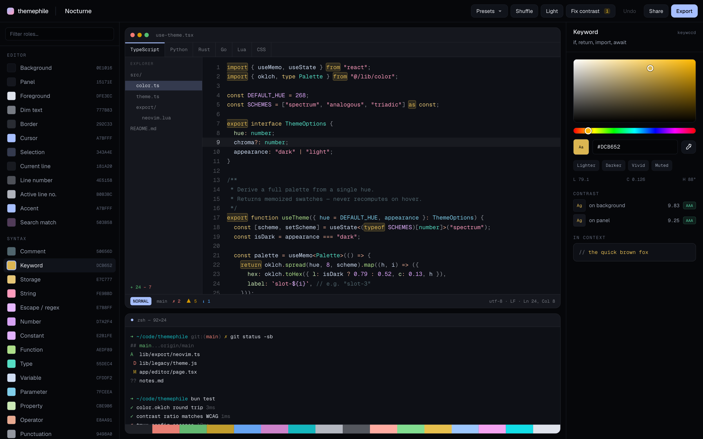
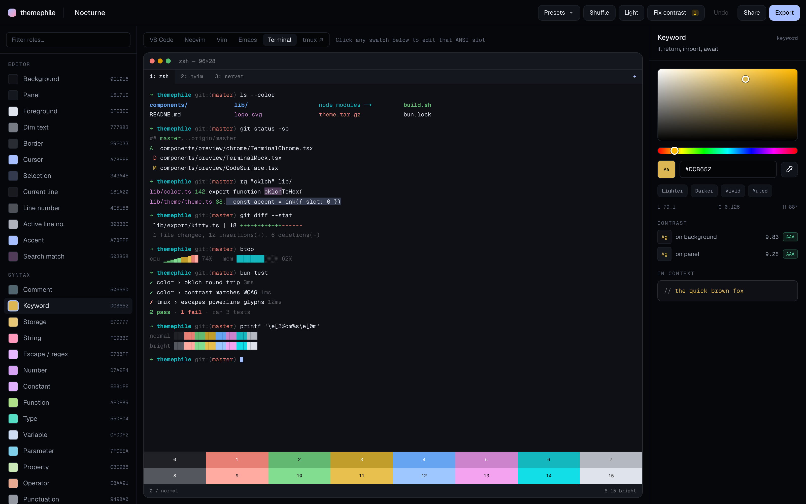
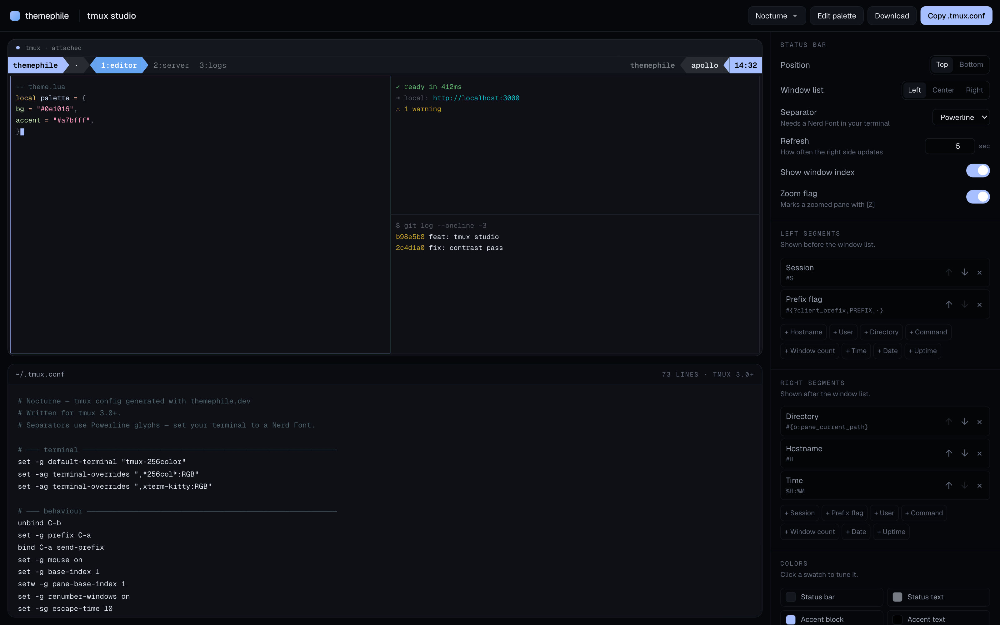

<div align="center">


# themephile

**A visual theme editor for code — and a tmux status bar builder.**
Tune every syntax color against real code, then copy a finished config
for your editor, your terminal, or tmux. The editor never asks you to sign in.

[](LICENSE)
[](https://nextjs.org)
[](#privacy)

</div>

---

## What it is

Most theme editors want an account before they'll let you pick a shade of blue.
This one doesn't ask. Everything that makes a theme — the palette generator,
the syntax highlighter, all ten exporters, and the importer that reads someone
else's theme file — runs in your browser, signed out, forever.

There is a gallery, and it does have a database. The line is drawn at the point
where you'd be writing to a space other people share: **reading is anonymous,
writing needs an identity.** Browsing, opening, editing and exporting a
published theme never involve an account. Publishing one, or liking one, does.

There are three tools.

### Theme editor



Every token in the preview is a hit target. Click a keyword, edit the keyword
color. Select a role and it lights up everywhere it appears — in the code, in the
chrome, in the terminal.

**Five previews, one theme.** A colorscheme doesn't look the same in every
program, so the preview switches between them and draws each as itself:

| Preview | What it shows |
| --- | --- |
| **VS Code** | Activity bar, explorer with git letters, tabs, breadcrumbs, a live minimap, status bar |
| **Neovim** | Relative line numbers, sign column with git and diagnostic signs, inline virtual text, a floating `Pmenu`, powerline statusline |
| **Vim** | `~` filler past the buffer (visible, unlike Neovim's hidden `EndOfBuffer`), line-wise visual selection, plain statusline, `-- INSERT --` |
| **Emacs** | Fringes, region highlight, the boxed modeline in its real `-UUU:----F1` format, and the echo area |
| **Terminal** | Tab bar, `ls --color`, git status, a search match, a selection, test output, and normal-against-bright rows — plus a clickable ANSI 16 grid |

- **48 editable roles** — editor surface, 16 syntax roles, diagnostics, and the ANSI 16
- **Six languages** live-previewed: TypeScript/JSX, Python, Rust, Go, Lua, CSS
- **Shuffle** builds a whole coherent theme from a seed — hue, harmony scheme, chroma
- **Fix contrast** counts the roles failing WCAG AA-large and lifts them without touching hue
- Undo, eyedropper, live contrast ratios, and a share link that carries the entire palette

Opening **Export** lands on whichever program you're previewing.



### Import a theme you already have

**Import** takes the file two ways, because the formats split two ways. A VS
Code theme is something you copy out of a gist; an `.itermcolors` is something
you have on disk and have never once opened in an editor. So: paste it into the
box, or drop the file anywhere on the dialog. Both run the same reader, in your
browser.

| Read | From |
| --- | --- |
| **VS Code** | Workbench colors, TextMate scopes, semantic tokens. Handles JSONC — comments and trailing commas — because real themes are full of both. |
| **Neovim** | `nvim_set_hl` calls, `hl()` wrappers, or plain group tables, with `c.blue`-style palette references resolved. |
| **Vim** | `hi Group guifg=…` lines, plus `g:terminal_ansi_colors`. |
| **Emacs** | A `deftheme` — `let` bindings resolved through `custom-theme-set-faces`. |
| **base16 / base24** | Both the classic flat form and tinted-theming's `palette:` nesting. |
| **Terminals** | Alacritty (TOML *and* the older YAML), kitty, Ghostty, WezTerm, Windows Terminal, iTerm2 `.itermcolors`, Xresources. |
| **Anything else** | Any text with hex codes in it, sorted by lightness and hue into the nearest roles. |

Most formats are partial by nature — a kitty conf has sixteen ANSI colors and
nothing to say about comments. Rather than leave the gaps black, the missing
roles are derived from the ones that were found, following the [base16 styling
guideline](https://github.com/chriskempson/base16/blob/main/styling.md) for
which terminal color stands in for which syntax idea. The dialog then reports
the split — *"24 of 48 roles read from the file, 24 derived"* — and marks the
derived swatches with a dashed outline, so nothing is presented as having come
from your file when it didn't.

### Theme gallery

Published colorschemes, newest or most-liked, dark or light. Every card is a
real preview — the tokenizer runs on the server and the result ships as plain
HTML, so a gallery page carries no client-side rendering cost and a crawler
reads the same code a person does.

Opening one loads the whole palette from the URL fragment, so it lands in the
editor without a lookup and works even if the original is later deleted. From
there it's an ordinary theme: change what you want, export it, or publish your
own version.

Each theme gets its own page — every role, every hex code as real text — and
its own social card painted in its own palette.

### tmux studio



Build your status bar by looking at it: reorder segments, switch separators,
set pane borders and the prefix key, and watch a live terminal redraw. Out comes
a complete `.tmux.conf`.

Browsers have no Nerd Font, so the preview draws powerline separators as CSS
shapes — identical silhouette, no tofu — while the exported config uses the real
`U+E0B0` glyphs.

## Exports

| Target | What you get |
| --- | --- |
| **VS Code** | Workbench chrome, TextMate scopes, semantic tokens, plus a `package.json` so it installs as a local extension. Works in Cursor and Windsurf. |
| **Neovim** | Lua colorscheme with treesitter captures, LSP semantic tokens, diagnostics, and groups for gitsigns / telescope / nvim-tree / cmp. |
| **Vim** | Classic vimscript with 256-color `cterm` fallbacks, so it survives SSH. |
| **Emacs** | `deftheme` covering font-lock (including the Emacs 29+ tree-sitter faces), org, diffs, and completion popups. |
| **Terminals** | Alacritty, kitty, Ghostty, WezTerm, Windows Terminal. |
| **tmux** | A full `.tmux.conf` — status bar, panes, messages, key bindings. |
| **JSON** | Every role as flat, stable keys, for writing your own exporter. |

Each one ships with install steps: where the file goes and what to type.

## Quick start

```bash
make             # install, check the environment, start the dev server
```

That's the whole golden path. The other targets:

```bash
make build       # production build
make check       # tsc, eslint, and a build — what CI runs
make db-push     # create the database if needed, then apply every migration
make update      # newest dependencies, clean rebuild
```

**The gallery is optional, and it degrades in two independent steps.** Without
`TURSO_DATABASE_URL` the editor and tmux studio work exactly as documented and
`/themes` renders a "not configured" notice. With a database but no GitHub app,
the gallery is fully readable and crawlable but can't take new themes — the
sign-in button hides itself rather than offering something that can only fail.
So you never need to provision anything to hack on the editor.

Next.js 16 (App Router), React 19, Tailwind CSS v4, and `@libsql/client` for
the gallery alone. The syntax highlighter, the color math, every exporter and
every importer are local code with no dependencies at all.

## Privacy

**The editor and tmux studio never talk to a server.** Your theme is saved to
`localStorage` and encoded into the URL *fragment* — the part after `#`, which
browsers do not transmit — so sharing a link shares the whole palette without
anything touching a database. Importing reads the file in the tab; nothing is
uploaded. No analytics, no telemetry, no cookies.

**The gallery has a database**, and it would be dishonest to keep claiming
otherwise. What it stores: for a theme, its 48 colors, a name, an optional
one-line description, and who published it; for an account, only what GitHub
hands over at sign-in — your handle and avatar URL. No email is used for
anything, nothing is emailed, and deleting a theme deletes the row.

You can use every other part of the site without ever creating an account, and
nothing you do in the editor is visible to anyone until you press Publish.

## How it works

**One vocabulary, many targets.** Every editor names things differently — VS
Code has TextMate scopes, Neovim has treesitter captures, Emacs has font-lock
faces. themephile defines 48 neutral *roles* in the middle, and each exporter
translates from those. Pick a color once; it lands everywhere.

**Palettes are generated, not hand-picked.** A theme comes from a small seed —
a background, a foreground, a base hue, a harmony scheme, and a chroma
multiplier — expanded in OKLCh. Because the math is perceptual, "10% lighter"
means the same thing on yellow as it does on blue, and Shuffle produces coherent
themes instead of confetti. Every derived color stays editable.

**The highlighter is custom on purpose.** Off-the-shelf highlighters emit
TextMate scopes, and collapsing ~2000 scopes onto 16 editable roles is guesswork
in the wrong direction. Here each token is *born* as a role, which is what makes
clicking a token in the preview and clicking its swatch the same action. It's
approximate — there's no parser — but it only has to be convincing enough to
judge a color by.

## Layout

```
app/
  page.tsx            landing
  editor/page.tsx     theme editor    → components/editor/EditorApp
  tmux/page.tsx       tmux studio     → components/tmux/TmuxApp
  themes/             gallery index and one page per published theme, each
                      with a social card in its own palette; actions.ts holds
                      every mutation
  api/                auth callback, sign-out, and /api/me — the one uncached
                      request that keeps every other page cacheable
  icon.svg            the animated favicon
  apple-icon.tsx      iOS home-screen icon (iOS won't take an SVG)
  opengraph-image.tsx social card, one per route, generated from the real palette
  sitemap.ts          three static routes
  robots.ts           allow-all + sitemap pointer
  llms.txt/route.ts   derived from TARGETS/ROLE_IDS, so it can't describe a
                      product that no longer exists
lib/
  site.ts             canonical origin + shared OpenGraph fields
  seo/                JSON-LD graph, social-card renderer
  color.ts            OKLab/OKLCh conversion, WCAG contrast, xterm-256 matching
  theme/
    roles.ts          the 48 role ids — the vocabulary every exporter maps from
    theme.ts          seed → theme generator, contrast repair
    presets.ts        starting seeds
    serialize.ts      URL-fragment encoding, localStorage, downloads
  highlight/
    tokenize.ts       hand-rolled tokenizer (tsx, python, rust, go, lua, css)
    samples.ts        preview code
  export/             one module per target + the shared Vim/Neovim group table
  import/             format sniffing, one parser per format, and the
                      derivation that grows a partial read into all 48 roles
  env.ts              server-only config; what makes the gallery optional
  db/                 the libSQL client and row-narrowing helpers
  auth/               GitHub OAuth and the signed session cookie
  gallery/            queries and the palette <-> row conversion
  tmux/               config model and .tmux.conf generator
components/
  preview/
    CodeSurface.tsx   the syntax-highlighted buffer, with per-editor gutters
    PreviewStage.tsx  the target switcher
    chrome/           one component per program: VS Code, Neovim, Vim, Emacs, Terminal
  editor/             role list, inspector, color picker, export/import/publish
  gallery/            cards, like button, auth button, session provider
  tmux/               status bar, terminal preview, controls
```

Adding a sixth preview means writing one `chrome/` component against the shared
`ChromeProps` and adding a row to `PREVIEW_TARGETS`. `CodeSurface` already
handles relative line numbers, sign columns, virtual text, selections, search
matches, and buffer filler, so most of the work is layout.

Both workspaces read browser state during their first render, so they mount with
`ssr: false` behind a prerendered skeleton — the static shell ships instantly and
there's no flash of the default theme before your saved one appears.

## Adding an export target

Implement `ExportTarget` (`lib/export/types.ts`) — an id, a label, a `files()`
returning one or more `{ filename, language, contents }`, and `install()` steps —
then add it to `TARGETS` in `lib/export/index.ts`. The export dialog, the landing
page list, and the download buttons pick it up automatically.

Vim and Neovim share one highlight-group table (`lib/export/groups.ts`) so the
two colorschemes can't drift apart.

## How the gallery is built

SQLite on [Turso](https://turso.tech), and about 150 lines of auth.

**The browser never touches the database.** The Turso token is a server-only
secret, so every read goes through a server component or route handler and
every write goes through a server action. There is no row-level security here
and no per-column grants, because there is no untrusted client on the other end
of the connection — authorisation lives in `app/themes/actions.ts`, and every
action re-establishes who is asking rather than trusting that the UI only
rendered the button for the right person. Next's framework check compares
`Origin` to `Host` and stops there; the rest is ours.

**Pages stay cacheable anyway.** Gallery pages are public content that renders
identically for everyone, so they remain statically cached and fully crawlable.
The only person-shaped state — are you signed in, which themes have you liked —
comes from one uncached request to `/api/me` after hydration. One uncacheable
request buys a fully cacheable page.

**Sign-in is the GitHub OAuth web flow, by hand.** Send the user to GitHub with
a `state` we can recognise, verify it came back unchanged, trade the `code` for
a token, ask who they are, then throw the token away. No scope is requested, so
the grant covers public profile data only. The session is a stateless cookie
signed with HMAC-SHA256 via Web Crypto — no session table, no dependency, and
`crypto.subtle.verify` is constant-time, which is the property a hand-rolled
comparison usually gets wrong. It's `HttpOnly` and `SameSite=Lax`; Lax rather
than Strict because the OAuth callback is a top-level navigation from
github.com and Strict would withhold the cookie on exactly that hop.

**Identity is the GitHub numeric id, never the handle.** Handles can be renamed
and the old one becomes available to someone else, so matching on the handle
would eventually hand one person's themes to another.

Slug allocation catches the unique-constraint violation and retries rather than
checking first: two people publishing "Nord" in the same second would both see
the name as free, so the index has to be the authority.

The rest of the schema notes — why `like_count` is denormalized, why
`updated_at` is written by the application instead of a trigger, why palette
validation is a trigger rather than a `CHECK` — are in [`db/README.md`](db/README.md).

## Verification

The generated configs are checked against the real programs, not just eyeballed:
the Emacs theme loads under `emacs --batch`, the Vim colorscheme sources under
`vim -es -u NONE`, and every `.tmux.conf` variant boots a real `tmux` server with
no errors.

## Contributing

Issues and pull requests are welcome. New export targets, new import formats,
new preset seeds, and tokenizer fixes for languages that look wrong are all good
places to start.

An importer is a `Parser` (`lib/import/types.ts`): an id, a label, a cheap
`detect()` sniff, and a `parse()` that returns whatever roles it can find.
Detection is deliberately optimistic — a format only wins if its parser actually
returns something — so add it to `PARSERS` above the vaguer formats and below
the more specific ones.

## License

[MIT](LICENSE) © justin06lee
